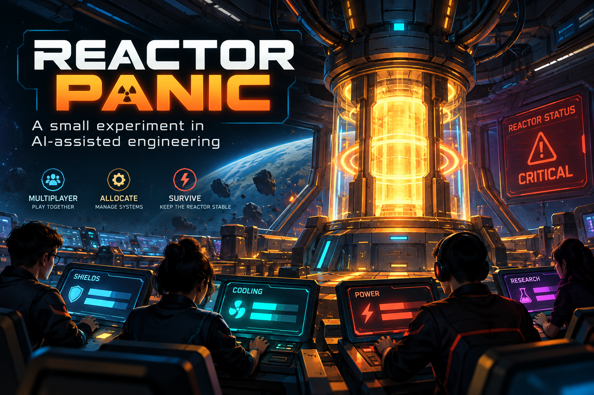

# Reactor Panic



[Play Reactor Panic](https://reactor-panic-sudarshan.novalensnorth.chatgpt.site)

A browser-based, seven-round social strategy game for 3–8 players. Everyone shares a failing reactor, but each player builds a personal captain score. Players enter by nickname and six-character room code or invite link. No account is needed.

## AI generation and human direction

The application code for Reactor Panic was completely AI-generated. I did not hand-write the game implementation. My contribution was the product idea, the engineering direction, and the decisions that shaped the result.

I built this as an experiment in directing AI through a software development lifecycle. I used different AI tools for distinct parts of the work, rather than expecting one conversation to produce a finished game in a single pass.

### How I approached the project

1. **Ideation with ChatGPT.** I explored a multiplayer social-strategy concept and developed Reactor Panic as its own game: a failing space station where players balance collective survival against personal advantage. I shaped the requirements and the experience I wanted to build.
2. **Implementation with Codex.** I used Codex to generate the application code and turn the requirements into a working game. My role was to steer scope, clarify behavior, and make decisions as the implementation evolved.
3. **Review and testing with Claude.** I used Claude as a separate review/testing step, feeding its findings back into the coding workflow instead of relying only on the coding tool's assessment of its own work.
4. **Concise Markdown handoffs.** Review findings were captured in short Markdown files and passed back to Codex. This kept feedback actionable and reduced repeated context and token consumption across tools.
5. **Iterative fixes and local validation.** I repeated the implement–review–fix cycle and tested locally before deployment. The approach followed an SDLC: define the problem, implement, review, validate, correct, and then deploy.

AI generated the code; I directed the process and evaluated the result. The experiment was about applying engineering judgment to AI-driven execution: maintaining context, making trade-offs, and carrying feedback through to a usable product.

### Scope of validation

The repository contains automated game-engine, multi-client, and concurrency checks, described below. These checks are not a claim of comprehensive production assurance. **Performance testing and penetration testing were not performed as part of this experiment.** AI-generated code still requires review, testing, and maintenance.

## Technology

- TypeScript and React with Next.js-style application routes
- Vinext and Vite for the Cloudflare Workers runtime
- Cloudflare D1 with Drizzle schema and migrations
- Tailwind CSS and shared UI components
- Node.js test runner for deterministic game-rule checks

## Game design

- **Cadence:** Seven rounds, each with an 80-second secret decision and 12-second reveal. A full game takes about 11 minutes plus lobby time. The server owns deadlines and resolution.
- **Energy:** Players begin with 4 energy. Allocate whole units among repair, shield, investigate, recharge, and at most one sabotage. Sabotage costs 2. Unspent energy carries over; each round adds 2 base energy, recharge adds 2 more per unit, and the cap is 6.
- **Reactor:** Starts at `10 + 2 × player count` health. A public event deals 3–6 base damage plus `floor(player count / 3)`. Shield blocks 2 damage per energy; repair restores 2 health per energy after damage. Some events modify these values. Health is capped at its start value.
- **Scoring:** Repair and investigation give 2 points per energy; shield gives 2 if any shield is useful, otherwise 1. The signal event adds 1 investigation point per energy. Sabotage gives 3 points if the station survives, but exposure costs 4 and station failure costs sabotagers 6. All players lose 4 if the reactor fails. Seven-round survival gives everyone 3; a completed private objective grants 5.
- **Risk control:** Total sabotage damage is capped at 2 per round regardless of saboteur count. Sabotage alone cannot remove the reactor's last health point. Investigation raises the seeded exposure chance. A player who misses a turn uses safe autopilot repair and earns no points for that turn.
- **End:** The game ends after round 7 or immediately when reactor health reaches zero. The highest score wins the captain's record, including after early failure; ties share the title. Private objectives are revealed only at the end.

### Worked rounds

With 3 players, maximum reactor health is 16. A meteor event deals `6 + floor(3/3) = 7` damage. Ada spends 2 on repair (+4 health, +4 score); Bex spends 1 on shield (blocks 2, +2 score); Cy spends 2 on investigation (+4 score). The reactor goes from 16 to `16 − (7 − 2) + 4 = 15`. Ada, Bex, and Cy gain 4, 2, and 4 captain points.

If one player also sabotages, the same round takes up to 2 additional damage. Investigation increases the chance of exposing that player, which removes 4 points. If the reactor fails, all players lose 4 and each saboteur loses a further 6 instead of gaining 3. The damage cap and failure penalty limit griefing without removing the risky choice.

### Auditability and secrecy

The server generates a 256-bit seed for each round and publishes its SHA-256 commitment before accepting actions. The event is public; the seed is not. The seed and all actions appear only after resolution. The browser verifies that the revealed seed matches the earlier commitment. Resolution uses a deterministic integer PRNG, so the event and exposure draws can be reproduced from the seed. Objectives use a separate secret seed, disclosed only at game end; revealing the first round seed cannot reveal other players' objectives. Individual player passes are random 256-bit tokens stored only in that player's browser and compared by hash on the server. A player view includes only its own pending action and objective; other players expose a submitted flag.

Room updates use one JSON state row in Cloudflare D1 with a version check (`UPDATE ... WHERE version = ?`). Conflicting writes retry, so concurrent joins, starts, and actions cannot silently overwrite one another. The client polls about every 1.5 seconds and sends heartbeat updates every 10 seconds. Reconnect uses the saved pass in browser storage. A disconnected player keeps their seat; missing decisions use autopilot. If a lobby host has been absent for 60 seconds, control passes to an active crew member, who can remove the absent seat before launch.

## Local setup

Requires Node.js 22.13 or later. From the project directory:

```bash
npm ci
npm run build
node --import ./scripts/sites-env.mjs ./node_modules/wrangler/bin/wrangler.js d1 execute DB --local --config dist/server/wrangler.json --persist-to .wrangler/state --file drizzle/0000_nifty_maddog.sql
npm start -- --port 8787
```

Open `http://127.0.0.1:8787`. Apply the migration only once to a fresh local D1 database. Subsequent runs need only `npm start -- --port 8787`; rebuild after source edits. For an easier development loop, `npm run dev` starts the local framework server after the migration is applied.

## Checks

```bash
node --test tests/engine.test.mjs
./node_modules/.bin/tsc --noEmit
npm run build
node tests/multiclient.mjs
node tests/concurrency.mjs
```

The multi-client check uses the running local server and waits through a real 80-second deadline. It covers three independent player passes, joining, ready/start, secret action visibility, invalid action rejection, and timed disclosure. The concurrency check sends seven joins at once and verifies that no seat is overwritten.

## Deployment in ChatGPT Work

This project is configured for **Sites** with a D1 binding named `DB` in `.openai/hosting.json`. Publish the source through the Sites workflow; Sites provisions D1 and applies the checked-in Drizzle migration before deploying the Worker. The app must be shared with **public access** for anonymous friends to join by link. The room itself remains discoverable only by its random code or invitation link. Avoid posting private room links publicly.

No external API keys or login provider are required. The server must run as a Worker with a D1 binding; a static host alone cannot run room or action APIs. Persistent room data is removed lazily after 48 hours when new rooms are created. The game uses frequent polling rather than WebSockets; state normally appears on other screens within about 1.5 seconds.

## Code map

- `lib/game.ts`: pure deterministic rules, events, objectives, scoring, and round resolution
- `lib/server.ts`: room persistence, optimistic concurrency, validation, tokens, view filtering, and rate limits
- `app/api/rooms`: create, join, read, and command routes
- `app/page.tsx`, `app/globals.css`: responsive game UI
- `db/schema.ts`, `drizzle/`: D1 schema and migration
- `tests/`: rule and multi-client checks
